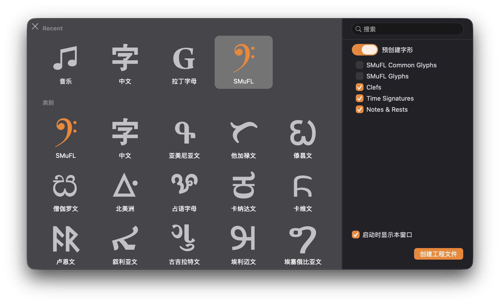
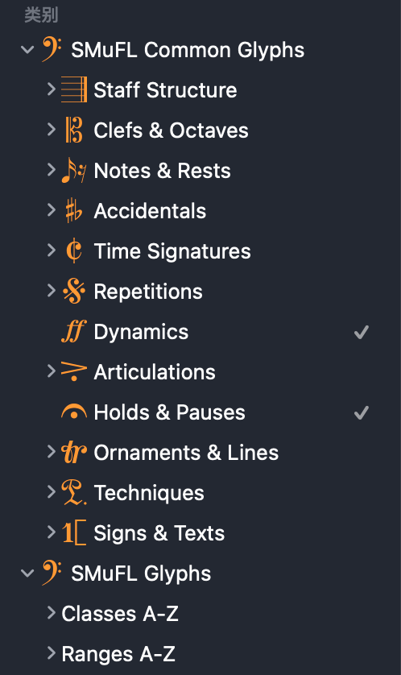

# SMuFL for Glyphs 4

> 文档以中文为准。[English](i18n/README.en.md) · [日本語](i18n/README.ja.md)

Glyphs 4 是一款 macOS 应用。本仓库为它提供 SMuFL 分类表和字体元数据导出插件；数据来自 SMuFL 1.5 (draft) 官方元数据。安装器同时兼容 Glyphs 3 的目录结构。

## 截图

启动窗口（5 个预创建入口）：



侧边栏（两个分类）：



## 分类表

| 项目 | 数量 |
|---|---|
| 字形 | 2,940 |
| classes | 85 |
| ranges | 132 |
| 侧边栏分类 | `SMuFL Common Glyphs`、`SMuFL Glyphs` |
| 启动窗口入口 | 5 |

```text
SMuFL Common Glyphs
├── Staff Structure
├── Clefs & Octaves
├── Notes & Rests
├── Accidentals
├── Time Signatures
├── Repetitions
├── Dynamics
├── Articulations
├── Holds & Pauses
├── Ornaments & Lines
├── Techniques
└── Signs & Texts

SMuFL Glyphs
├── Classes A-Z
└── Ranges A-Z
```

启动窗口提供 5 个预创建入口：`SMuFL Common Glyphs`（916）、`SMuFL Glyphs`（2,940）、`Clefs`（61）、
`Time Signatures`（32）、`Notes & Rests`（172）。字形按 Unicode 码位排序。

锚点：选中字形后执行 **Glyph > Set Anchors（⌘U）**，会写入
`opticalCenter`（Dynamics）以及 `stemUpSE`、`stemDownNW` 等（音符类）。
详见 [`docs/ANCHORS.md`](docs/ANCHORS.md)。

### 安装

用 `release/pkg/` 里的安装包：

| 包 | 作用 |
|---|---|
| `SMuFL-Glyphs.pkg` | 安装分类表 |
| `SMuFL-Glyphs-Uninstall.pkg` | 卸载分类表 |
| `SMuFL-Metadata.pkg` | 安装导出插件 |
| `SMuFL-Metadata-Uninstall.pkg` | 卸载导出插件 |

装完 ⌘Q 退出 Glyphs 再打开。首次打开未签名安装包会被 macOS 拦截，处理步骤和手动安装见 [`release/README.md`](release/README.md)。

## 导出器

从 Glyphs 4 的 Script 菜单运行，生成 SMuFL 字体元数据 JSON：
`fontName`、`fontVersion`、`designSize`、`sizeRange`、`engravingDefaults`、
`glyphAdvanceWidths`、`glyphsWithAnchors`、`glyphBBoxes`、`glyphsWithAlternates`、
`ligatures`、`sets`、`optionalGlyphs`。不修改 `.glyphs` 工程。

安装：双击 `release/pkg/SMuFL-Metadata.pkg`，或把
`release/manual/SMuFL Metadata/SMuFL Metadata.glyphsPlugin` 复制到：

```text
~/Library/Application Support/Glyphs 4/Plugins/
```

配置见 [`plugin/README.md`](plugin/README.md)。

## 重建

```bash
python3 tools/build_all.py
./install/build-release.sh
```

只依赖 Python 标准库。侧边栏结构在
[`data/layout/legacy.json`](data/layout/legacy.json)，只存分组名和 range/class 引用；
锚点规则在 [`data/layout/anchors.json`](data/layout/anchors.json)。
详见 [`docs/BUILD.md`](docs/BUILD.md)。

## 许可

Apache-2.0，见 [`LICENSE`](LICENSE)。第三方署名在 [`NOTICE`](NOTICE)：
SMuFL 规范（FSA）、GlyphsSDK（Apache-2.0）、Bravura 参考数据（OFL-1.1）、
Naruto 图标（© YH & Kiyoaki）。

## 致谢

[SMuFL](https://www.w3.org/community/music-notation/)、
[GlyphsSDK](https://github.com/schriftgestalt/GlyphsSDK)、
[Bravura](https://github.com/steinbergmedia/bravura)、
Naruto 音乐字体（侧边栏图标）。
