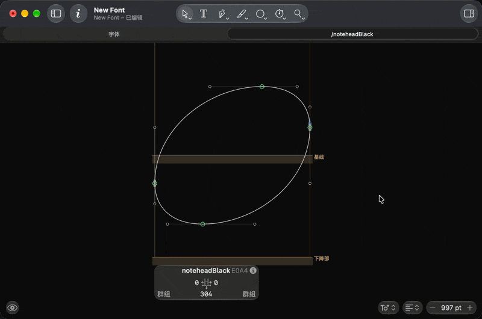

# Anchors

> Chinese is the primary language. [中文](ANCHORS.md) · [日本語](ANCHORS.ja.md)

The `anchors` attribute of `GlyphData` supports positioned anchors:

```xml
<glyph name="ogonek" anchors="ogonek@maxX;baseline" .../>
```

The syntax is `name@x-expression;y-expression`, comma-separated. Variables:

| Variable | Meaning |
|---|---|
| `minX` / `maxX` / `width` / `centerX` | horizontal |
| `minY` / `maxY` / `height` / `centerY` | vertical |
| `baseline` / `ascender` / `descender` / `xHeight` / `capHeight` | vertical metrics |

## Usage



Glyphs does **not** add these anchors when a glyph is created; it applies them
when you run **Glyph > Set Anchors (Cmd-U)**. If you do not need anchors, do
not press Cmd-U and the glyph stays clean.

## Sources

| File | Content |
|---|---|
| `data/layout/anchors.glyphs.json` | Per-glyph anchors: Bravura 1.482 `glyphsWithAnchors` + `glyphBBoxes`, normalized to expressions; 586 glyphs |
| `data/layout/anchors.json` | Per-range fallback rules: Dynamics, noteheads, accidentals, multi-segment lines |

Per-glyph data wins; the range rules only fill the gaps. 1,016 glyphs currently
carry anchors, covering `stemUpSE`, `stemDownNW`, `splitStem*`, `cutOut*`,
`noteheadOrigin`, `opticalCenter`, `repeatOffset`, `graceNoteSlash*` and more.

Coordinates are Bravura's staff-space values quantized to
`minX/centerX/maxX` and `minY/centerY/maxY/baseline` relative to each glyph's
bounding box. They are approximations; adjust by hand when needed.

## Editing

- One glyph: edit its entry in `anchors.glyphs.json`.
- A whole range: edit `rules` in `anchors.json`; `ranges` uses keys from
  `data/upstream/ranges.json`.

```bash
python3 tools/build_all.py
```
